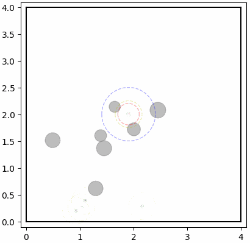
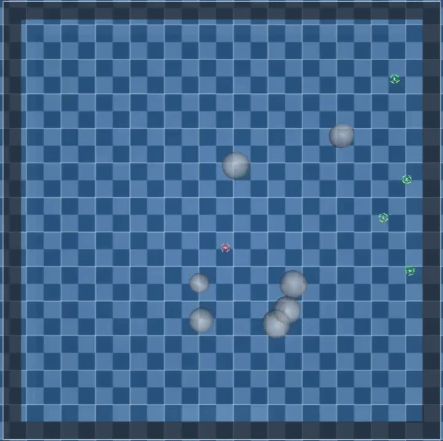

# Build Setup

------------
First, please make sure you have installed Conda. Then, our environment can be installed by:

    conda create -n SCOPE python=3.9.23
    conda activate SCOPE
    pip install -r requirements.txt

# Key Dependencies

------------
Lower versions are not guaranteed to be feasible:

    numpy: 1.26.3
    gym: 0.26.2
    pillow: 10.2.0
    torch: >=2.4.0+cu124
    torchaudio: >=2.4.0+cu124
    torchvision: >=0.19.0+cu124

# Project Structure

------------
	├── agents
	│	└── scope_agents.py   		// SCOPE agents
	├── crazyfile					// MuJoCo simulator
	├── envs
	│	├── icons
	│	├── CBF.py   				// CBF constraints
	│	├── math_tools.py
	│	└── UAVEnv.py   			// environment
	├── layers
	├── memory
	│	└── memory.py   			// experience buffer
    ├── model
	│	└── scope.py   		    	// SCOPE
	├── result
	│	└── scope
	│		├── frames
	│		├── roundup_success.gif
	│		├── roundup_fail.gif
	├── tmp				        	// Model path
	│	└── scope
	│		├── UAV_Round_up
	│		└── SPDM.pt				// Model of SPDM
	├── train_logs
	├── trainer
		└── scope
			├── dynamics_models
			│	├── Dlinear.py
			│	\vdot
			│	└── TimesNet.py
			├── dynamics_models.py
			├── scope_test.py		// Test
			├── scope_train.py		// Train
			├── sim.py				// Test on MuJoCo

# Sim Result

------------

  
  

## Explanation of Document

------------
- Surrogate dynamics model: ported from THUML's [Time-Series-Library](https://github.com/thuml/Time-Series-Library);
- Physics simulator: MuJoCo -> [google-deepmind/mujoco](https://github.com/google-deepmind/mujoco);
- UAV MuJoCo quadrotor model (`crazyfile`): adapted from LGQWakkk's [Quadrotor-NMPC-Control](https://github.com/LGQWakkk/Quadrotor-NMPC-Control/tree/main/crazyfile) repository.
